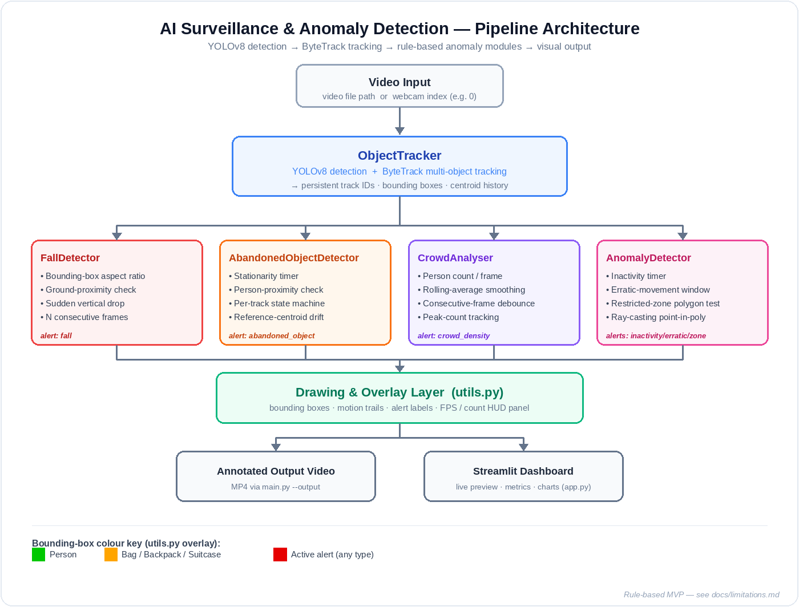

# 🎥 AI Surveillance & Anomaly Detection System

> **Real-time video analytics pipeline using YOLOv8, ByteTrack, and OpenCV —
> detecting falls, abandoned objects, crowd density, and suspicious behaviour.**

[](https://python.org)
[](https://ultralytics.com)
[](https://streamlit.io)
[](LICENSE)
[]()

---

## ⚠️ Privacy & Ethics Notice

> This project is for **educational and portfolio purposes only**.
> All sample videos used are **public domain or synthetic**.
> **Do not** use this system with private CCTV footage or any recordings without
> explicit legal authorisation and informed consent.
> See [`docs/limitations.md`](docs/limitations.md) for a full ethics discussion.

---

## 📌 Project Overview

This system demonstrates a complete computer vision pipeline for CCTV-style
video analytics.  It processes video frame-by-frame, applies YOLOv8 object
detection, assigns persistent tracking IDs via ByteTrack, and applies
configurable rule-based anomaly detection logic to flag potential incidents.

The project is structured as a professional, recruiter-ready codebase with:
- A modular, extensible Python architecture
- A Streamlit dashboard for non-technical stakeholders
- A CLI for automated batch processing
- Full config-driven thresholds (no hard-coded magic numbers)

---

## 🧠 Features

| Feature | Details |
|---------|---------|
| **Object Detection** | YOLOv8n/s/m — people, backpacks, handbags, suitcases |
| **Multi-Object Tracking** | ByteTrack with persistent IDs and centroid history |
| **Fall Detection** | Bounding-box aspect ratio + sudden vertical drop heuristic |
| **Abandoned Object Detection** | Stationarity timer + person proximity check |
| **Crowd Analysis** | Real-time people count with configurable density alerts |
| **Suspicious Inactivity** | Flags persons stationary beyond a time threshold |
| **Erratic Movement** | Flags rapid centroid displacement anomalies |
| **Restricted Zone Alerts** | User-defined polygon ROIs with zone-breach detection |
| **Streamlit Dashboard** | Upload video, tune thresholds, view metrics |
| **CLI Processing** | `main.py` for headless / automated use |
| **Motion Trails** | Visual centroid trails drawn per track |

---

## 🏗️ Architecture



<details>
<summary>Text version (for terminals / raw markdown viewers)</summary>

```
Video Input (file / webcam)
        │
        ▼
┌──────────────────┐
│  ObjectTracker   │  YOLOv8 + ByteTrack → tracked detections + IDs
└──────────────────┘
        │
   ┌────┴─────────────────────────────────────────┐
   │                                              │
   ▼                                              ▼
┌─────────────┐  ┌──────────────┐  ┌──────────────┐  ┌─────────────────┐
│FallDetector │  │AbandonedObj  │  │CrowdAnalyser │  │AnomalyDetector  │
│             │  │Detector      │  │              │  │ - Inactivity    │
│AR heuristic │  │Stationarity  │  │Count + alert │  │ - Erratic move  │
│+ drop check │  │+ proximity   │  │threshold     │  │ - Zone breach   │
└──────┬──────┘  └──────┬───────┘  └──────┬───────┘  └───────┬─────────┘
       └────────────────┴──────────────────┴──────────────────┘
                                   │
                                   ▼
                    ┌──────────────────────────┐
                    │  Drawing & Overlay Layer  │
                    │  (utils.py)               │
                    └──────────────────────────┘
                                   │
                  ┌────────────────┴────────────────┐
                  ▼                                 ▼
          Output Video (MP4)              Streamlit Dashboard
```

</details>

---

## 📁 Repository Structure

```
AI-Surveillance-Anomaly-Detection/
│
├── app.py                   # Streamlit dashboard
├── main.py                  # CLI entry point
├── requirements.txt
├── requirements-dev.txt     # Testing dependencies (pytest)
├── pytest.ini               # Test discovery configuration
├── config.yaml              # All thresholds (editable)
├── LICENSE
├── .gitignore
│
├── src/
│   ├── __init__.py
│   ├── detector.py          # YOLOv8 wrapper (standalone detection)
│   ├── tracker.py           # ByteTrack wrapper + centroid history
│   ├── fall_detection.py    # Aspect-ratio + drop heuristic
│   ├── abandoned_object.py  # Stationarity + proximity logic
│   ├── crowd_analysis.py    # People count + density alerts
│   ├── anomaly_detector.py  # Inactivity / erratic / zone breach
│   ├── utils.py             # Drawing, FPS counter, video helpers
│   └── video_processor.py  # Pipeline orchestrator
│
├── tests/
│   ├── __init__.py
│   ├── helpers.py            # Synthetic track builder for tests
│   ├── test_fall_detection.py
│   ├── test_abandoned_object.py
│   ├── test_crowd_analysis.py
│   └── test_anomaly_detector.py
│
├── sample_videos/
│   └── README.md            # Where to download test videos
│
├── outputs/
│   └── README.md
│
├── assets/
│   └── README.md
│
└── docs/
    ├── methodology.md       # How each module works
    └── limitations.md       # Honest limitations + future work
```

---

## ⚙️ Setup

### Prerequisites

- Python 3.9 or higher
- pip
- (Optional but recommended) a CUDA-capable GPU for real-time performance

### 1. Clone the repository

```bash
git clone https://github.com/YOUR_USERNAME/AI-Surveillance-Anomaly-Detection.git
cd AI-Surveillance-Anomaly-Detection
```

### 2. Create a virtual environment

```bash
# macOS / Linux
python3 -m venv .venv
source .venv/bin/activate

# Windows
python -m venv .venv
.venv\Scripts\activate
```

### 3. Install dependencies

```bash
pip install --upgrade pip
pip install -r requirements.txt
```

> **Note:** PyTorch will be installed as a CPU-only build by default.
> For GPU support, follow the instructions at https://pytorch.org/get-started/locally/
> before running `pip install -r requirements.txt`.

### 4. Download a test video

See [`sample_videos/README.md`](sample_videos/README.md) for free, legal sources.
Place the video at `sample_videos/demo.mp4`.

The YOLOv8 model weights (`yolov8n.pt`) are downloaded automatically on first run.

---

## 🚀 Usage

### CLI

```bash
# Process a video file and save annotated output
python main.py --input sample_videos/demo.mp4 --output outputs/result.mp4

# Webcam (index 0), no output file
python main.py --input 0

# Override thresholds from CLI
python main.py --input sample_videos/demo.mp4 --output outputs/result.mp4 --conf 0.5 --crowd 5

# Headless (no preview window) for server use
python main.py --input sample_videos/demo.mp4 --output outputs/result.mp4 --no-show

# See all options
python main.py --help
```

### Streamlit Dashboard

```bash
streamlit run app.py
```

Opens in your browser at `http://localhost:8501`.
- Upload a video or enter a file path
- Adjust sliders in the sidebar
- Click **▶ Run Analysis**
- View live preview and metrics
- Download the annotated output video

---

## 🔧 Configuration

All thresholds live in `config.yaml` — edit it to tune the system for your scene
without touching any Python code.

```yaml
detection:
  confidence_threshold: 0.4   # Raise to reduce false positives
  model_name: "yolov8n.pt"    # swap to yolov8s.pt / yolov8m.pt for accuracy

crowd_analysis:
  crowd_threshold: 8          # People count that triggers a crowd alert

fall_detection:
  aspect_ratio_threshold: 1.2 # w/h ratio that looks "fallen"
  consecutive_frames: 8       # Frames before alert fires

abandoned_object:
  stationary_seconds: 10      # Seconds before an object is "abandoned"
  proximity_threshold: 120    # Pixels within which a person "attends" the object

suspicious_behaviour:
  inactivity_seconds: 20      # Seconds of stillness before inactivity alert
```

### Restricted Zones (optional)

Define polygon ROIs in `config.yaml`:

```yaml
restricted_zones:
  zones:
    - name: "Server Room Door"
      points: [[100, 150], [400, 150], [400, 450], [100, 450]]
```

---

## 📊 Output

The annotated video includes:

- **Green boxes** — tracked persons
- **Orange boxes** — tracked bags/luggage
- **Red boxes** — any active alert
- **Alert labels** — `⚠ FALL DETECTED`, `⚠ ABANDONED OBJECT`, etc.
- **Motion trails** — last 20 centroid positions
- **HUD overlay** — live FPS, person count, and alert count

---

## 🧪 Tech Stack

| Component | Technology |
|-----------|-----------|
| Object Detection | [YOLOv8](https://github.com/ultralytics/ultralytics) |
| Multi-Object Tracking | [ByteTrack](https://github.com/ifzhang/ByteTrack) (via Ultralytics) |
| Video Processing | [OpenCV](https://opencv.org/) |
| Numerical Computation | [NumPy](https://numpy.org/) |
| Data Handling | [Pandas](https://pandas.pydata.org/) |
| Dashboard | [Streamlit](https://streamlit.io/) |
| Deep Learning Runtime | [PyTorch](https://pytorch.org/) |
| Configuration | [PyYAML](https://pyyaml.org/) |
| Logging | [Loguru](https://github.com/Delgan/loguru) |
| Testing | [pytest](https://pytest.org/) |

---

## ✅ Running Tests

The four rule-based anomaly modules (`fall_detection`, `abandoned_object`,
`crowd_analysis`, `anomaly_detector`) are covered by a unit test suite that
runs on synthetic track data — **no YOLO model, video file, or GPU required**.

```bash
pip install -r requirements-dev.txt
pytest
```

Expected output: all tests under `tests/` pass (24 tests at last count),
verifying the alert-triggering logic, debounce/consecutive-frame behaviour,
and state cleanup for each module in isolation.

---

## 📈 Performance (indicative)

| Model | Input Size | Approx. FPS (CPU, i7) | Approx. FPS (GPU, RTX 3060) |
|-------|-----------|----------------------|------------------------------|
| yolov8n | 640×640 | 8–12 | 60–80 |
| yolov8s | 640×640 | 5–8  | 40–60 |
| yolov8m | 640×640 | 2–4  | 25–40 |

Processing uses single-threaded OpenCV; a multi-threaded pipeline would
improve throughput significantly.

---

## 📝 Recruiter Summary

This project demonstrates the ability to:
- **Apply SOTA deep learning models** (YOLOv8) to real video streams without training from scratch
- **Design a multi-module CV pipeline** with clean interfaces between detection, tracking, and analytics
- **Implement practical anomaly heuristics** — fall detection, abandoned object timers, crowd density
- **Build a usable product** with both a CLI and an interactive Streamlit dashboard
- **Think about production realities** — config-driven thresholds, error handling, logging, and an honest limitations analysis

This is an **MVP** — see [`docs/limitations.md`](docs/limitations.md) for the honest
constraints and [`docs/methodology.md`](docs/methodology.md) for the technical detail.

---

## 📚 Further Reading

- [YOLOv8 Documentation](https://docs.ultralytics.com/)
- [ByteTrack Paper](https://arxiv.org/abs/2110.06864)
- [CAVIAR Dataset](https://homepages.inf.ed.ac.uk/rbf/CAVIARDATA1/)
- [ShanghaiTech Anomaly Dataset](https://svip-lab.github.io/dataset/campus_dataset.html)

---

## 🤝 Contributing

Pull requests are welcome.  For major changes, please open an issue first to
discuss what you would like to change.

---

## ⬆️ Pushing This Project to GitHub

If you're setting this project up from scratch (not cloning an existing repo),
here's how to get it onto GitHub:

### 1. Initialise a local git repository

```bash
cd AI-Surveillance-Anomaly-Detection
git init
git add .
git commit -m "Initial commit: AI Surveillance & Anomaly Detection System"
```

### 2. Create a new repository on GitHub

1. Go to [github.com/new](https://github.com/new)
2. Repository name: `AI-Surveillance-Anomaly-Detection`
3. Add the short description from the [GitHub tagline](CAREER_MATERIALS.md) in `CAREER_MATERIALS.md`
4. **Do not** initialise with a README, .gitignore, or licence (you already have these locally)
5. Click **Create repository**

### 3. Link and push

```bash
git branch -M main
git remote add origin https://github.com/YOUR_USERNAME/AI-Surveillance-Anomaly-Detection.git
git push -u origin main
```

### 4. Verify before pushing (recommended)

Double-check the following are **not** committed:
- Large model weight files (`*.pt`) — these are auto-downloaded, not stored in git
- Any real/private video footage — only sample or synthetic videos belong here
- Processed output videos in `outputs/` (already excluded via `.gitignore`)

```bash
git status        # confirm only source files are staged
cat .gitignore    # confirm exclusions are in place
```

### 5. (Optional) Add topics & a social preview

On the GitHub repo page → **Settings** → add topics such as:
`computer-vision`, `yolov8`, `object-tracking`, `opencv`, `streamlit`,
`anomaly-detection`, `python`, `portfolio-project`

This improves discoverability when recruiters browse GitHub by topic.

### 6. Future updates

```bash
git add .
git commit -m "Describe your change here"
git push
```

---

## 📄 Licence

[MIT](LICENSE) — free to use, modify, and share with attribution.

---

*Built for educational and portfolio purposes. Not for production surveillance deployment.*

